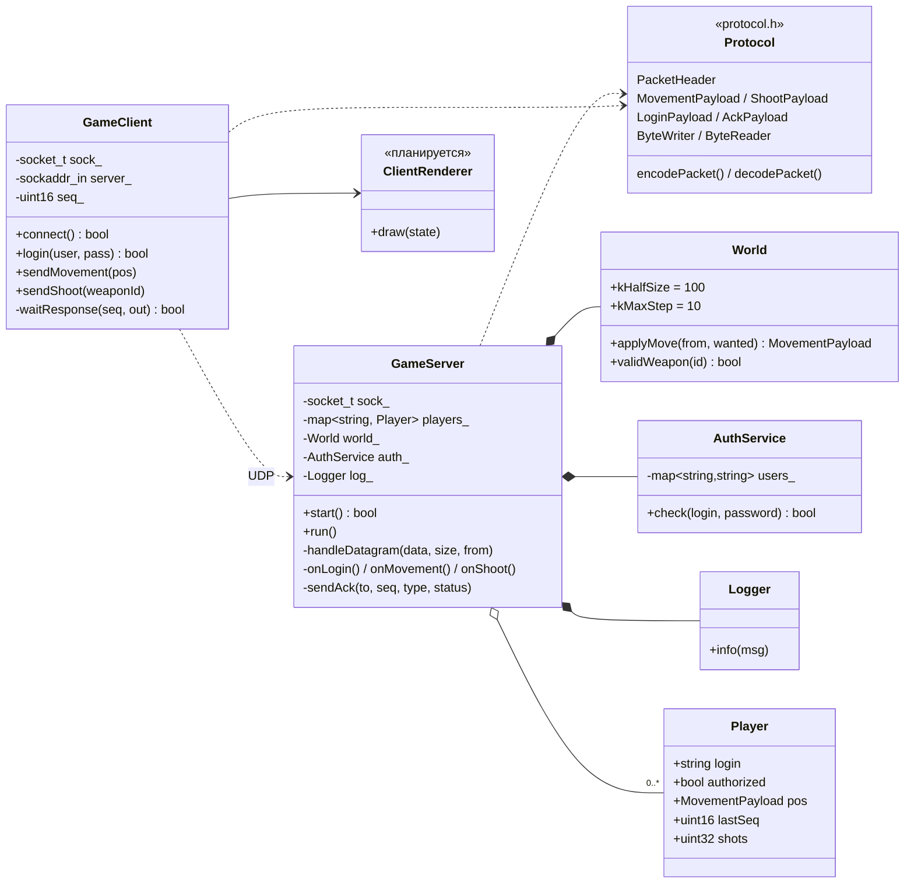
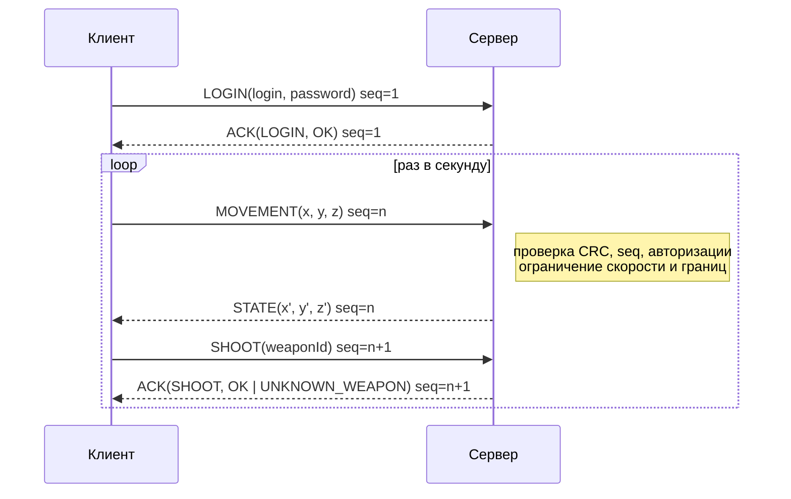

# Архитектура сетевой игры

## 1. Жанр и требования

**Жанр:** командный арена-шутер (FPS) от первого лица, матчи по 5–10 минут.

| Критерий              | Значение для проекта                                   |
|-----------------------|--------------------------------------------------------|
| Число игроков в матче | 2–16                                                   |
| Допустимая задержка   | < 100 мс RTT (попадания должны засчитываться честно)   |
| Частота обновлений    | 20–60 тиков/с, мелкие частые пакеты → **UDP**           |
| Античит               | важен: позиции и попадания нельзя доверять клиенту     |
| Бюджет                | учебный: один сервер (VPS / локальная машина)          |

## 2. Выбор топологии

| Топология            | Плюсы                                          | Минусы                                                          | Вывод |
|----------------------|------------------------------------------------|-----------------------------------------------------------------|-------|
| **Dedicated Server** | единый авторитет, защита от читов, равный пинг для всех, хост не влияет на матч | нужна серверная машина и её поддержка                          | ✅ выбрано |
| Listen Server        | бесплатно, сервер встроен в клиент хоста       | у хоста нулевая задержка (нечестно), матч умирает при выходе хоста, хост может читерить | ✗ |
| Peer-to-Peer         | нет сервера, минимальная задержка между парами | N² соединений, сложная синхронизация, каждый пир - потенциальный читер, проблемы NAT | ✗ |
| Relay                | решает NAT, скрывает IP игроков                | лишний «прыжок» увеличивает задержку, авторитета всё равно нет  | ✗ |

**Обоснование.** Для шутера главное - честность попаданий и одинаковые условия для всех
игроков. Dedicated Server даёт **авторитетный сервер**: клиент лишь сообщает о намерениях
(«хочу переместиться в точку X», «стреляю из оружия N»), а сервер проверяет их по правилам
мира и рассылает итоговое состояние. При 16 игроках нагрузка на один сервер небольшая
(16 клиентов × 60 пакетов/с ≈ 1000 пакетов/с), а бюджет учебного проекта позволяет
запустить сервер на любой машине.

## 3. Распределение обязанностей

| Компонент   | Отвечает за                                                                                  | НЕ отвечает за |
|-------------|----------------------------------------------------------------------------------------------|----------------|
| **Сервер**  | авторизацию, хранение состояния мира и игроков, проверку и применение команд (скорость, границы мира, валидность оружия), отбрасывание повреждённых/устаревших пакетов, журнал команд | отрисовку, ввод |
| **Клиент**  | чтение ввода, формирование команд, отправку их с заданной частотой, приём и отображение авторитетного состояния | итоговые позиции и попадания (только предлагает) |
| **Протокол** (общий код) | формат пакетов, сериализацию с фиксированным порядком байт, CRC32 | игровую логику |

Пример авторитетности в текущей реализации: клиент запрашивает позицию `(46.2, 55.6, -31.5)`,
но сервер ограничивает перемещение 10 единицами за команду и границами мира `[-100; 100]`,
поэтому возвращает `STATE (5.46, 2.05, -11.19)`. Клиент обязан принять позицию сервера.

## 4. Схема классов



### Файлы

```
src/common/net.h        - обёртка над сокетами (Winsock / POSIX)
src/common/crc32.h      - CRC32 для поля checksum
src/common/protocol.h   - типы пакетов, структуры, сериализация
src/server/udp_server.cpp - GameServer, World, Player, AuthService, Logger
src/client/udp_client.cpp - GameClient
src/echo/               - эхо-сервер и эхо-клиент (этапы 2–3)
tests/test_protocol.cpp - тесты сериализации и CRC32
```

## 5. Схема взаимодействия



## 6. Планы развития

- серверный тик (фиксированная частота) и рассылка состояния всех игроков (snapshot);
- клиентское предсказание и интерполяция для сглаживания задержки;
- надёжная доставка для важных событий (повторная отправка по таймауту ACK);
- проверка попаданий на сервере (raycast с учётом lag compensation).
